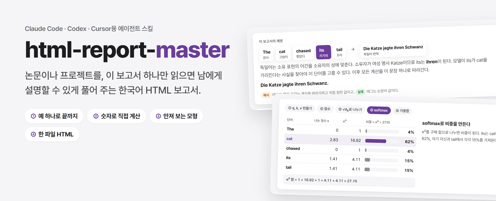
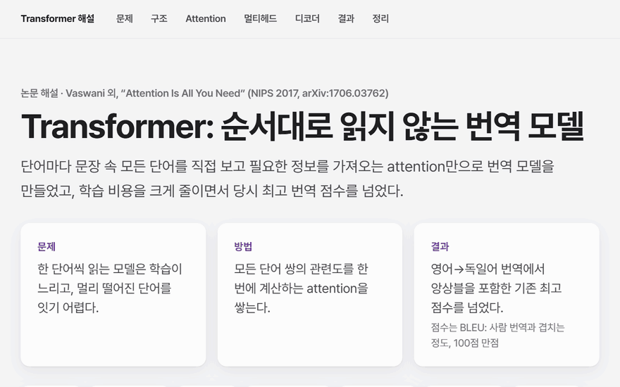
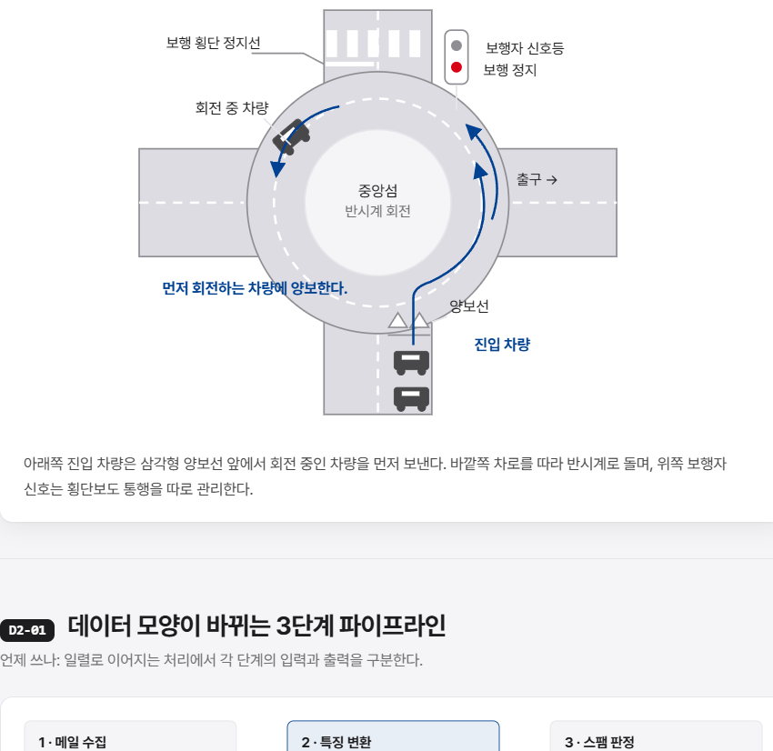
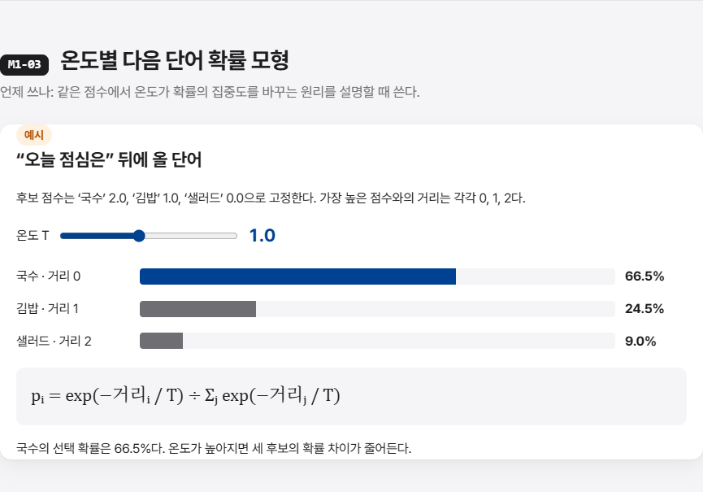
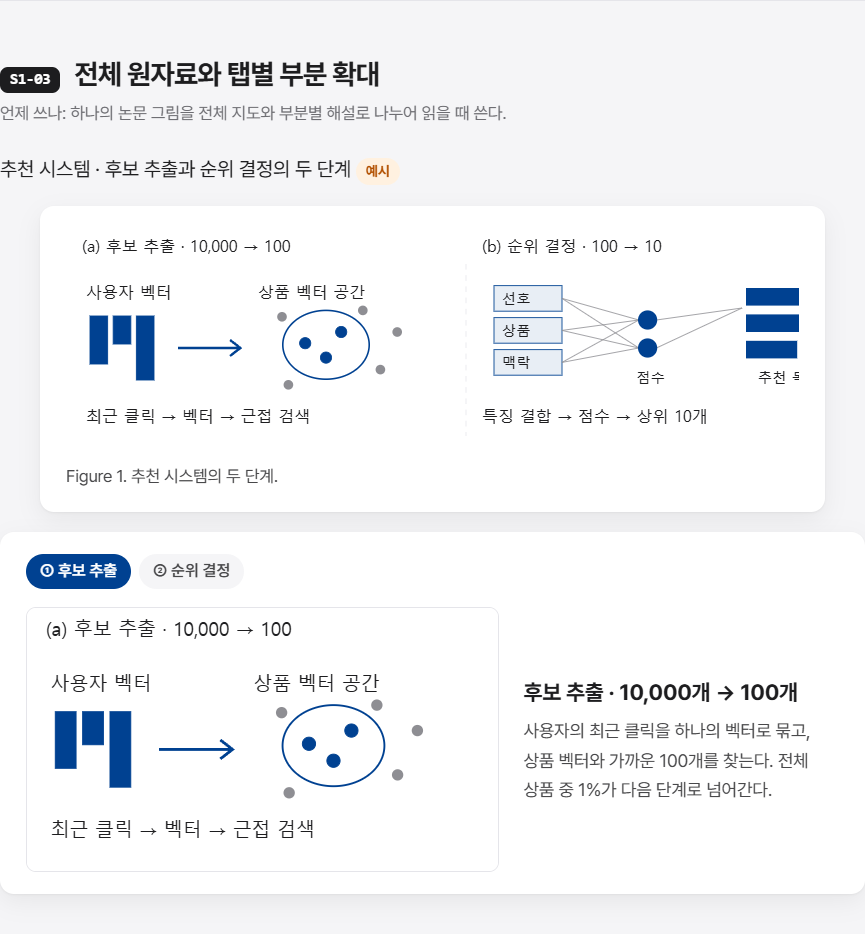
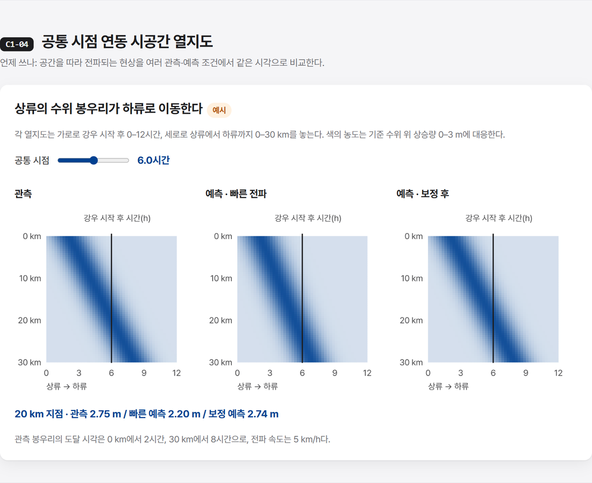
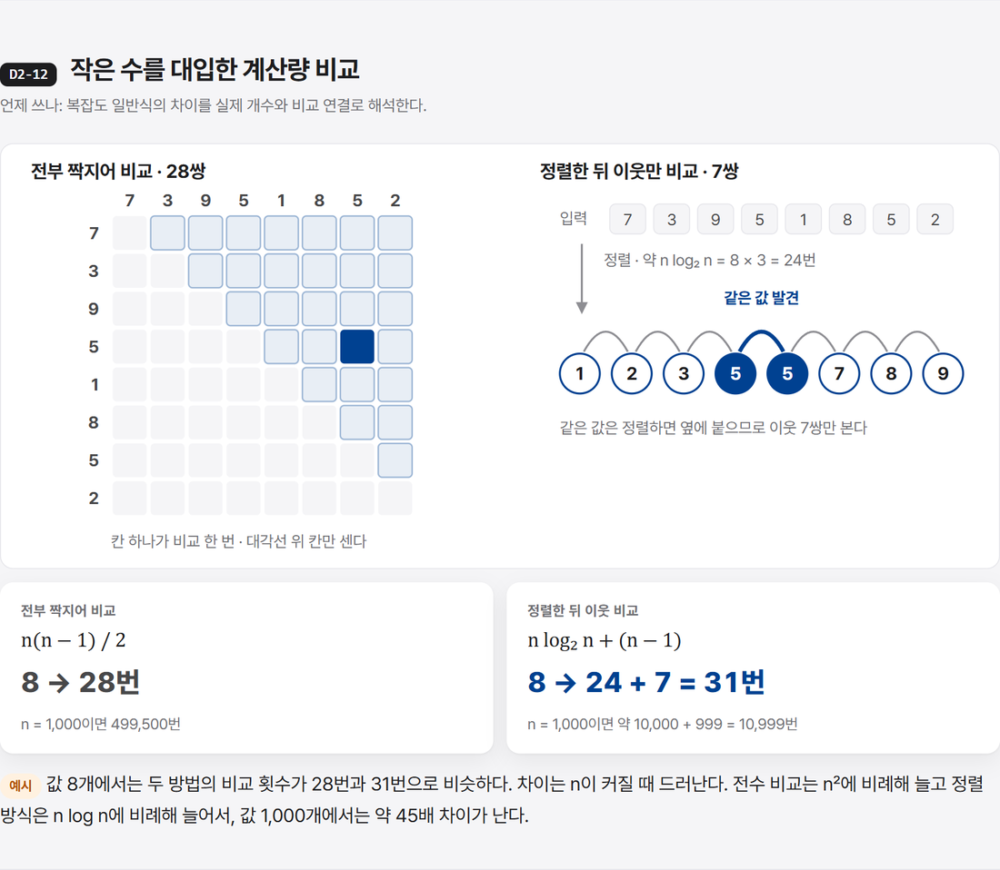
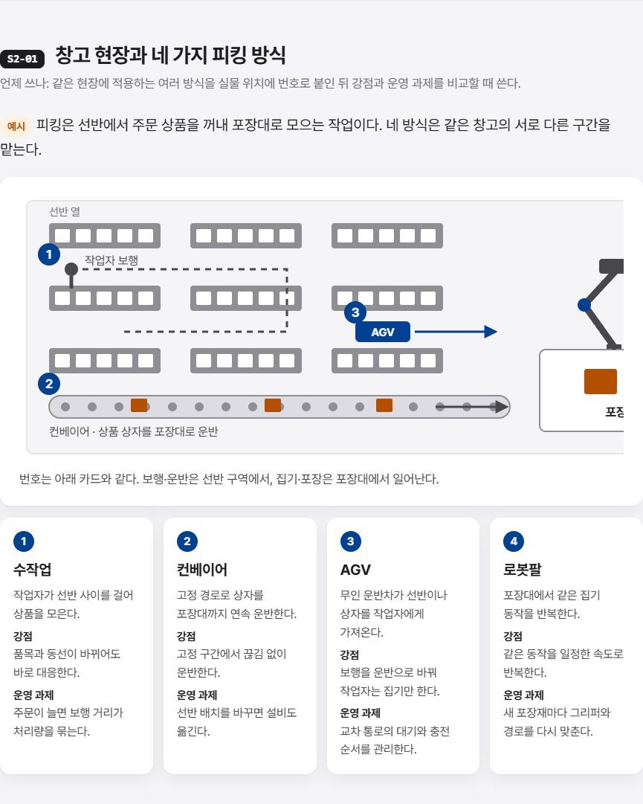

<picture>
  <source media="(prefers-color-scheme: dark)" srcset="docs/banner-dark.png">
  
</picture>

<p align="center">
  <a href="https://fosemfhtm.github.io/html-report-master/demo/transformer.html"><b>데모 보고서 열기</b></a> ·
  <a href="https://fosemfhtm.github.io/html-report-master/gallery.html"><b>부품 갤러리</b></a> ·
  <a href="https://fosemfhtm.github.io/html-report-master/motion.html"><b>모션 장면 갤러리</b></a> ·
  <a href="#설치"><b>설치</b></a>
</p>

<p align="center">
  <a href="LICENSE"></a>
  
  
  
</p>

연구실 미팅·논문 공유·진행 보고·아이디어 제안용 보고서를 AI 에이전트가 만들 때 쓰는 스킬이다. 여러 보고서를 직접 만들고 고치며 쌓은 기준을 담았다. 규칙을 잔뜩 거는 대신, 모델이 혼자 만들 때 반복해서 놓친 것들을 이유와 함께 짚어 준다.

## 데모

"Attention Is All You Need"를 이 스킬로 풀었다. 예문 하나(The cat chased its tail → Die Katze jagte ihren Schwanz)를 끝까지 들고 가며 q·k·v, 점수, softmax, 가중합을 숫자로 계산하고, 슬라이더로 √d<sub>k</sub>의 효과를 직접 움직여 본다.

<a href="https://fosemfhtm.github.io/html-report-master/demo/transformer.html"></a>

**스킬이 있을 때와 없을 때.** 같은 논문, 같은 요청("이 보고서만 읽으면 남에게 설명할 수 있게"), 같은 모델(Claude Sonnet 5.5)로 만들었다.

| | 스킬 없이 | 스킬 적용 |
|---|---|---|
| 예 | 계산은 "고양이 / 생선 / 먹었다", 구조는 "I am a student"로 따로 | 예문 하나로 처음부터 결과까지 |
| 계산 | 표 하나로 한 번 | 단계 탭 5개로 행렬 곱부터 가중합까지 |
| 움직여 보는 것 | 없음 | 슬라이더 5개, 단계 탭 3묶음 |
| 원문 그림 | 작게 통째로 | 구조도에서 설명하는 부분을 표시하고 탭과 연결 |
| 글 | 절 번호 표시(`§3.2.1`) 59곳, 예시·계산·비유·주의 라벨 | 장마다 한 문장 요약 뒤 설명 |

두 보고서 모두 열어 볼 수 있다: [스킬 적용](https://fosemfhtm.github.io/html-report-master/demo/transformer.html) · [스킬 없이](https://fosemfhtm.github.io/html-report-master/demo/transformer-noskill.html)

## 무엇을 하나

- **진짜 도식.** 글 상자를 화살표로 이은 가짜 도식 대신, 문장은 단어로, 행렬은 그 안의 값으로, 모듈은 입력이 어디로 들어가 무엇이 되는지로 그린다.
- **하나의 예로 끝까지.** 작은 예 하나를 정해 개념, 식, 계산, 결과를 그 위에서 설명한다. 핵심 식은 그 예의 숫자로 한 번 계산해 보인다.
- **만져 보는 모형.** 값을 바꾸면 결과가 눈에 띄게 달라지는 계산은 슬라이더와 단계 탭으로 직접 움직여 보게 만든다.
- **말하듯 쓰는 글.** 방어 문구, 메타 서술, 명세서식 나열, 작업 이력을 쓰지 않고, 동료에게 설명하듯 "~한다" 평서문으로 쓴다.
- **부품 갤러리 74개.** 큰 구조, 실물 도식, 작동 모형, 차트, 글 부품을 골라 쓴다. 주제는 모두 설명용 예시다.
- **한 파일 배포.** 글꼴·그림·상호작용을 모두 넣어 인터넷 없이 열리는 HTML 하나로 묶는다.
- **모션 발표.** 발표용 자료는 1920×1080 무대에서 스텝마다 멈추는 모션 덱으로 만든다. 제목은 주장 문장, 자막은 스텝마다 한두 문장, 움직임은 걸러 내기·이동·접기·교체처럼 과정을 설명할 때만 쓴다. 다크·라이트 테마, 한/영 전환(선택)을 파일 안에 넣는다. 장면 부품 9개.

| | |
|---|---|
|  |  |
|  |  |
|  |  |

## 설치

**여러 에이전트 공통 (Claude Code, Codex, Cursor, Gemini CLI 등)**

```bash
npx skills add fosemfhtm/html-report-master
```

**Claude Code 플러그인**

```
/plugin marketplace add fosemfhtm/html-report-master
/plugin install html-report-master@html-report-master
```

**직접 복사**: `skills/html-report-master/` 폴더를 에이전트의 스킬 폴더(예: `~/.claude/skills/`)에 넣는다.

필요한 것: Node 20 이상, Chrome 또는 Edge(스크린샷 확인용). 외부 npm 패키지는 쓰지 않는다.

## 쓰는 법

에이전트에게 평소처럼 부탁하면 된다.

> 이 논문 읽었는데, 이 보고서만 읽으면 남한테 설명할 수 있게 한국어 보고서로 만들어 줘.

> 이 프로젝트 폴더로 연구 아이디어 공유용 보고서 만들어 줘.

에이전트는 자료를 끝까지 읽고, HTML을 만들기 전에 장마다 청중이 가져갈 한 문장, 쓸 그림, 끝까지 들고 갈 예, 용어를 부를 방법, 강조색 후보를 표로 보여 준다. 승인하면 틀 위에서 만들고, 스크린샷으로 화면을 확인한 뒤 한 파일로 묶는다.

## 구성

```
skills/html-report-master/
  SKILL.md                    진행 순서와 자주 놓치는 것(원리 설명·그림·글)
  references/style.md         지적받은 문장과 고친 문장 사례
  references/narrative.md     장 구성, 글의 층, 이전에 실패한 이유
  references/design.md        색·글자·배치·부품
  references/gallery.md       부품 74개 목록과 언제 쓰는지
  references/motion.md        모션 발표의 화면·말투·움직임, 스토리보드, 장면 부품 목록
  assets/report_template.html 디자인 토큰과 페이지 뼈대
  assets/gallery.html         부품 갤러리 (브라우저로 열어 본다)
  assets/motion_template.html 모션 발표 엔진과 예시 장면 3개
  assets/motion_gallery.html  모션 장면 부품 9개 (Space로 넘겨 본다)
  assets/vendor/gsap.min.js   모션 엔진이 쓰는 GSAP 3.12.5
  assets/fonts/               Pretendard 가변 글꼴, JetBrains Mono(코드용 일부)와 라이선스
  scripts/                    강조색 찾기, 화면 폭별 스크린샷, 단일 파일 만들기
tools/gallery/                갤러리 부품 원본과 조립 스크립트
```

기본 강조색은 KAIST Dark Blue(`#004191`)다. 에이전트는 자료(코드의 색 설정, 그림, 로고)에서 다른 후보를 찾아 함께 제안하므로, 각자 바꿔 쓰면 된다.

## 부품 더하기

`tools/gallery/README.md`에 섹션 형식과 디자인·글 규칙이 있다. `tools/gallery/parts/`를 고친 뒤 `node tools/gallery/assemble.mjs`를 실행하면 갤러리와 목록이 다시 만들어진다.

## 라이선스

- 스크립트·문서·갤러리: [MIT](LICENSE)
- 글꼴 Pretendard: [SIL Open Font License 1.1](skills/html-report-master/assets/fonts/Pretendard-LICENSE.txt), © Kil Hyung-jin. 보고서 HTML에 글꼴을 넣어 배포하는 것은 허용된다. 글꼴을 수정해 배포할 때는 "Pretendard"라는 이름을 쓸 수 없다.
- 글꼴 JetBrains Mono(일부 글자만 담은 판): [SIL Open Font License 1.1](skills/html-report-master/assets/fonts/JetBrainsMono-LICENSE.txt), © The JetBrains Mono Project Authors.
- GSAP 3.12.5(`assets/vendor/gsap.min.js`): GreenSock의 [Standard License](https://gsap.com/standard-license)를 따른다. MIT 라이선스 대상이 아니다.
- 데모 보고서(`docs/demo/`)에 실은 원문 그림·표: Vaswani et al., "Attention Is All You Need"(NIPS 2017, arXiv:1706.03762). 논문 첫 쪽의 Google 허락 문구("Provided proper attribution is provided, Google hereby grants permission to reproduce the tables and figures in this paper solely for use in journalistic or scholarly works.")에 따라 출처를 밝혀 실었으며, MIT 라이선스 대상이 아니다.

---

**English summary.** An agent skill for Korean HTML research reports and stepped motion presentations that explain a paper or project well enough that readers no longer need the source. It steers models away from fake box-and-arrow diagrams and spec-sheet prose toward real diagrams, one running example with worked numbers, interactive models where they help, and plain spoken Korean. Ships with a 74-part report gallery, a 9-scene motion gallery (1920×1080 stage, step-by-step playback, dark/light themes, optional Korean/English toggle), design-token templates, and Node scripts for screenshots, per-step motion checks and single-file offline builds. Install with `npx skills add fosemfhtm/html-report-master`.
