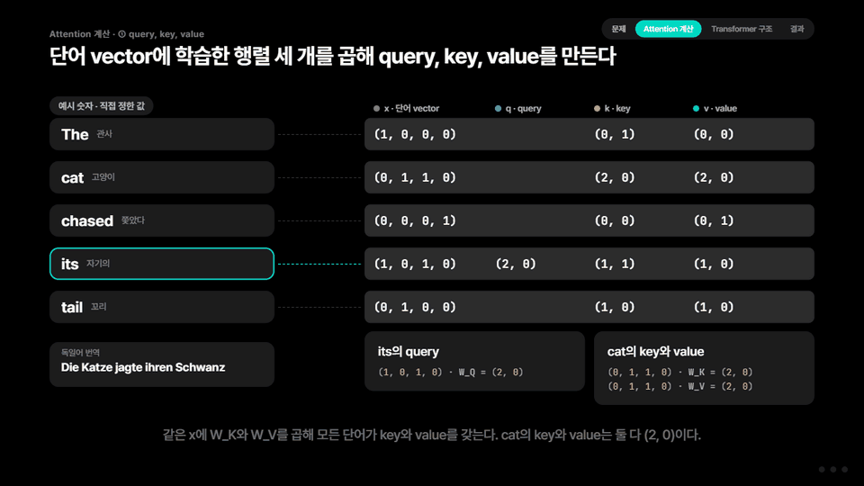
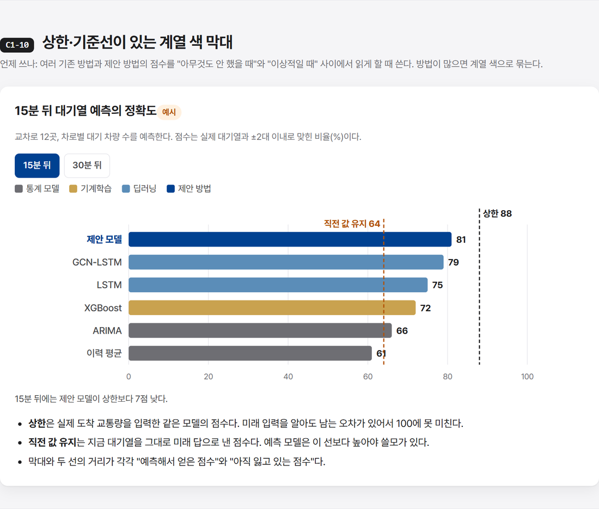
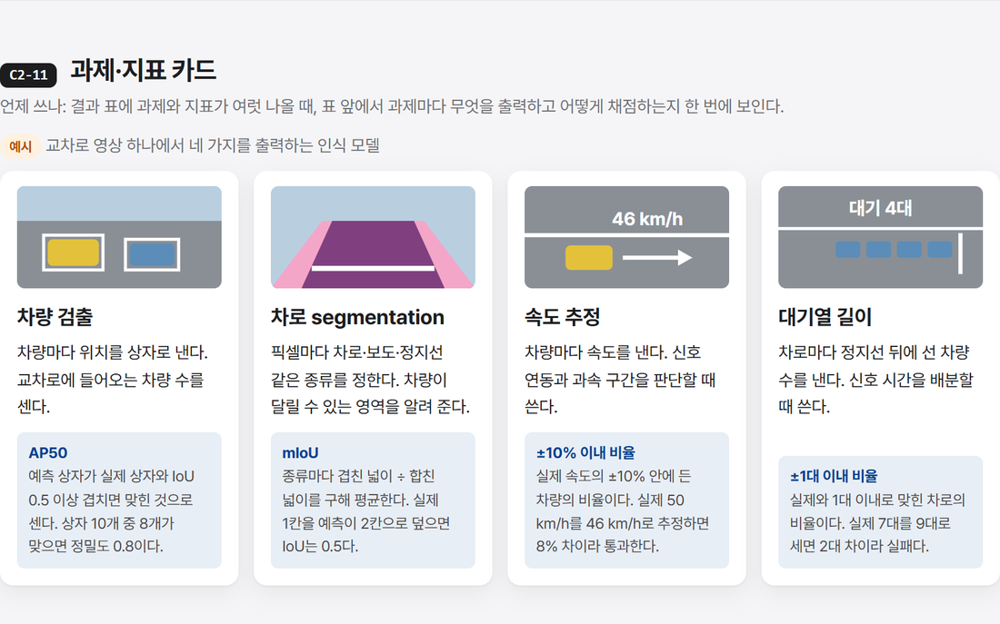
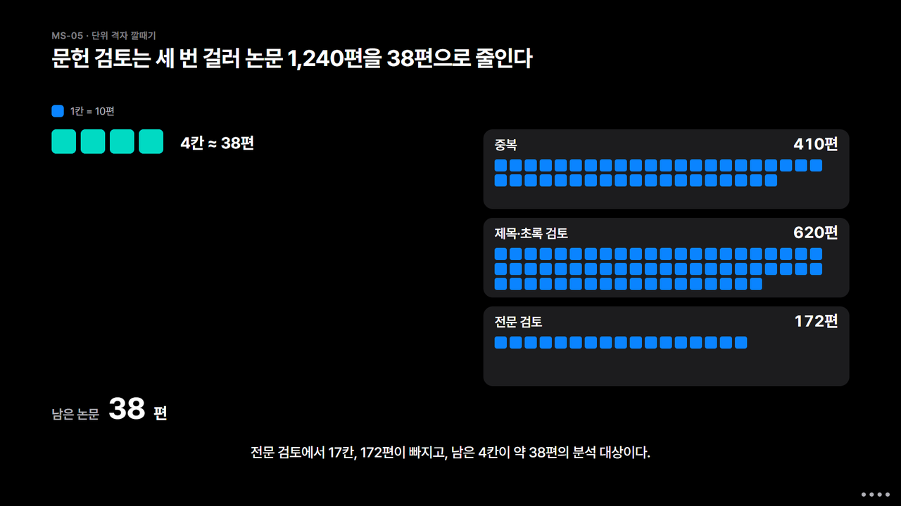
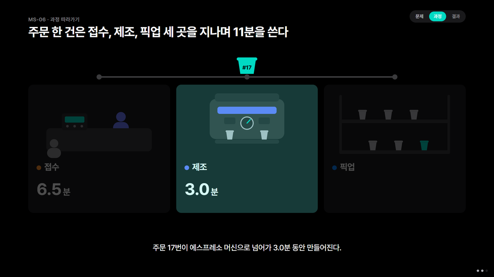
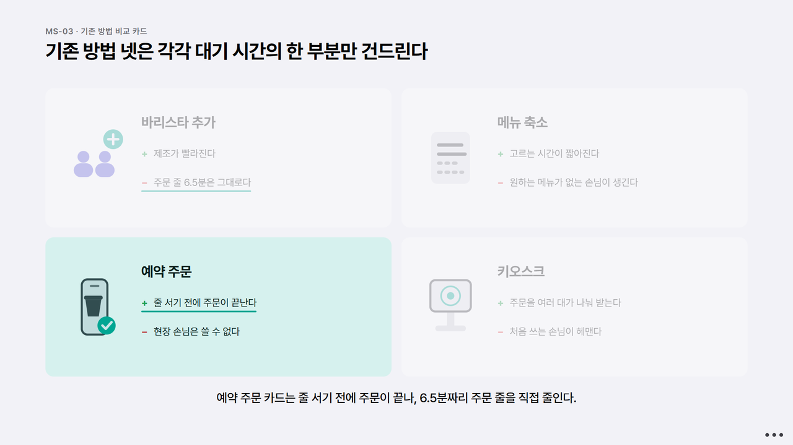
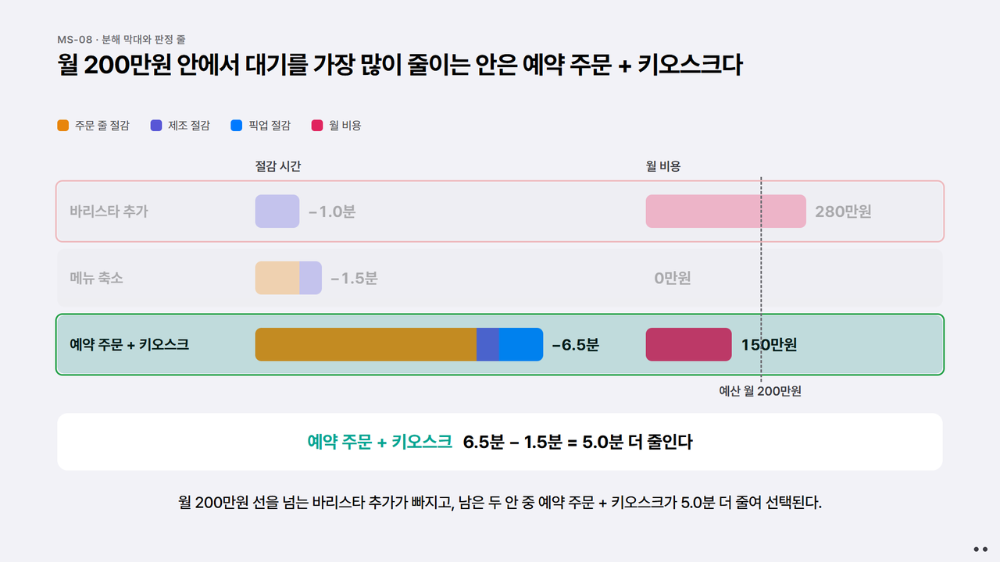

<picture>
  <source media="(prefers-color-scheme: dark)" srcset="docs/banner-dark.png">
  
</picture>

<p align="center">
  <a href="https://fosemfhtm.github.io/html-report-master/demo/transformer.html"><b>데모 보고서</b></a> ·
  <a href="https://fosemfhtm.github.io/html-report-master/demo/transformer-motion.html"><b>데모 발표</b></a> ·
  <a href="https://fosemfhtm.github.io/html-report-master/gallery.html"><b>보고서 부품 갤러리</b></a> ·
  <a href="https://fosemfhtm.github.io/html-report-master/motion.html"><b>발표 장면 갤러리</b></a> ·
  <a href="#설치"><b>설치</b></a>
</p>

<p align="center">
  <a href="LICENSE"></a>
  
  
  
</p>

연구실 미팅, 논문 공유, 진행 보고, 발표 자료를 AI 에이전트가 만들 때 쓰는 스킬이다. 목표는 하나다. 이 자료 하나만 보면 원 논문이나 프로젝트를 남에게 설명할 수 있어야 한다.

규칙을 잔뜩 거는 대신, 모델이 혼자 만들 때 반복해서 놓친 것들을 이유와 함께 짚어 준다. 여러 보고서와 발표를 직접 만들고 고치며 쌓은 기준이다.

## 두 가지 형태

| | 보고서 | 모션 발표 |
|---|---|---|
| 언제 | 읽고 공유하는 자료 | 말로 발표하는 자료 |
| 화면 | 스크롤하는 한 페이지, 장마다 그림·식·만져 보는 모형 | 1920×1080 무대, 장면마다 스텝으로 나눠 재생하고 스텝 끝에서 멈춤 |
| 글 | 장마다 한 문장 요약 뒤 설명 | 제목은 주장 문장, 자막은 스텝마다 한두 문장 |
| 조작 | 슬라이더, 단계 탭 | Space·← →, 장면 목록(G), 연속 재생(K), 다크·라이트(T), 한/영(L, 선택) |
| 틀 | `assets/report_template.html` | `assets/motion_template.html` |
| 부품 | 74개 | 장면 10개 |

두 형태 모두 글꼴·그림·상호작용을 넣은 HTML 한 파일로 묶여 인터넷 없이 열린다.

## 데모

"Attention Is All You Need"를 두 형태로 만들었다. 둘 다 예문 하나(The cat chased its tail → Die Katze jagte ihren Schwanz)를 끝까지 들고 가며 query·key·value, 점수, softmax, 가중합을 숫자로 계산한다.

**보고서.** 슬라이더로 √d<sub>k</sub>의 효과를 움직여 보고, 단계 탭으로 계산을 한 단계씩 넘긴다.

<a href="https://fosemfhtm.github.io/html-report-master/demo/transformer.html"></a>

**모션 발표.** 14장면, 40스텝이다. 왼쪽에는 예문이 늘 같은 자리에 있고, 오른쪽에서 점수가 한 쌍씩 계산되고 softmax 막대가 자라고 value가 하나로 합쳐진다.

<a href="https://fosemfhtm.github.io/html-report-master/demo/transformer-motion.html"></a>

**스킬이 있을 때와 없을 때.** 같은 논문, 같은 요청("이 보고서만 읽으면 남에게 설명할 수 있게"), 같은 모델(Claude Sonnet 5.5)로 보고서를 만들었다.

| | 스킬 없이 | 스킬 적용 |
|---|---|---|
| 예 | 계산은 "고양이 / 생선 / 먹었다", 구조는 "I am a student"로 따로 | 예문 하나로 처음부터 결과까지 |
| 계산 | 표 하나로 한 번 | 단계 탭 5개로 행렬 곱부터 가중합까지 |
| 움직여 보는 것 | 없음 | 슬라이더 5개, 단계 탭 3묶음 |
| 원문 그림 | 작게 통째로 | 구조도에서 설명하는 부분을 표시하고 탭과 연결 |
| 글 | 절 번호 표시(`§3.2.1`) 59곳, 예시·계산·비유·주의 라벨 | 장마다 한 문장 요약 뒤 설명 |

두 보고서 모두 열어 볼 수 있다: [스킬 적용](https://fosemfhtm.github.io/html-report-master/demo/transformer.html) · [스킬 없이](https://fosemfhtm.github.io/html-report-master/demo/transformer-noskill.html)

## 무엇을 하나

- **진짜 도식.** 글 상자를 화살표로 이은 가짜 도식 대신, 문장은 단어로, 행렬은 그 안의 값으로, 모듈은 입력이 어디로 들어가 무엇이 되는지로 그린다. 표에 색만 입힌 것도 도식으로 치지 않는다.
- **하나의 예로 끝까지.** 작은 예 하나를 정해 개념, 식, 계산, 결과를 그 위에서 설명한다. 핵심 식은 그 예의 숫자로 한 번 계산해 보인다.
- **결과의 "왜"까지.** 비교 기준은 무엇을 해서 얻은 값인지로 정의하고, 독자가 "저 방법은 왜 더 잘하지?"라고 물을 결과는 이유를 원 자료에서 확인해 쓴다.
- **움직임은 과정을 설명할 때만.** 보고서는 슬라이더와 단계 탭, 발표는 걸러 내기·따라가기·접기·전후 변형처럼 과정을 보여 주는 움직임만 쓴다. 짚을 때는 테두리 상자 대신 스포트라이트와 밑줄을 쓴다.
- **말하듯 쓰는 글.** 방어 문구, 메타 서술, 명세서식 나열, 작업 이력을 쓰지 않는다. 문단은 두세 문장으로 끊고, 분야에서 원어로 통하는 용어(segmentation, feature, baseline)는 원어로 둔다.
- **정돈된 화면.** 글자 크기는 몇 단계로만 쓰고, SVG 글자도 같은 단계로 보이게 맞춘다. 스크립트가 화면 폭별·스텝별로 넘침, 작은 글자, 자막 겹침을 찾아 준다.

## 갤러리

**보고서 부품 74개.** 큰 구조, 실물 도식, 작동 모형, 차트, 글 부품. 주제는 모두 설명용 예시다.

| | |
|---|---|
|  |  |
|  |  |
|  |  |
|  |  |

**발표 장면 10개.** 점심시간 카페 대기열 하나를 예로 표지부터 결론까지 이어진다.

| | |
|---|---|
|  |  |
|  |  |

## 설치

**여러 에이전트 공통 (Claude Code, Codex, Cursor, Gemini CLI 등)**

```bash
npx skills add fosemfhtm/html-report-master
```

**Claude Code 플러그인**

```
/plugin marketplace add fosemfhtm/html-report-master
/plugin install html-report-master@html-report-master
```

**직접 복사**: `skills/html-report-master/` 폴더를 에이전트의 스킬 폴더(예: `~/.claude/skills/`)에 넣는다.

필요한 것: Node 20 이상, Chrome 또는 Edge(스크린샷 확인용). 외부 npm 패키지는 쓰지 않는다.

## 쓰는 법

에이전트에게 평소처럼 부탁하면 된다.

> 이 논문 읽었는데, 이 보고서만 읽으면 남한테 설명할 수 있게 한국어 보고서로 만들어 줘.

> 이 프로젝트로 랩 미팅 발표 자료 만들어 줘. 모션으로.

에이전트는 자료를 끝까지 읽고, HTML을 만들기 전에 구성을 먼저 보여 준다. 보고서는 장마다 청중이 가져갈 한 문장, 쓸 그림, 끝까지 들고 갈 예, 용어를 부를 방법, 강조색 후보를 표로 보여 준다. 발표는 장면마다 제목, 스텝별 자막, 움직임을 쓴 스토리보드를 보여 준다. 승인하면 틀 위에서 만들고, 스크린샷으로 화면을 확인한 뒤 한 파일로 묶는다.

## 구성

```
skills/html-report-master/
  SKILL.md                    형태 고르기, 진행 순서, 자주 놓치는 것(원리 설명·그림·글)
  references/style.md         지적받은 문장과 고친 문장 사례
  references/narrative.md     장 구성, 글의 층, 이전에 실패한 이유
  references/design.md        색·글자·배치·부품
  references/gallery.md       보고서 부품 74개 목록
  references/motion.md        모션 발표의 화면·말투·움직임, 스토리보드, 장면 목록
  assets/report_template.html 보고서 틀
  assets/gallery.html         보고서 부품 갤러리
  assets/motion_template.html 모션 발표 엔진과 예시 장면
  assets/motion_gallery.html  발표 장면 갤러리 (Space로 넘겨 본다)
  assets/vendor/gsap.min.js   모션 엔진이 쓰는 GSAP 3.12.5
  assets/fonts/               Pretendard, JetBrains Mono(코드용 일부)와 라이선스
  scripts/                    강조색 찾기, 화면 폭별·스텝별 스크린샷 검사, 단일 파일 만들기
tools/gallery/                보고서 부품 원본과 조립 스크립트
tools/readme/                 README 배너 원본
```

기본 강조색은 보고서가 KAIST Dark Blue(`#004191`), 발표가 민트다. 에이전트가 자료(코드의 색 설정, 그림, 로고)에서 다른 후보를 찾아 함께 제안한다.

## 부품 더하기

- **보고서 부품.** `tools/gallery/README.md`에 섹션 형식과 규칙이 있다. `tools/gallery/parts/`를 고친 뒤 `node tools/gallery/assemble.mjs`를 실행하면 갤러리와 목록이 다시 만들어진다.
- **발표 장면.** `assets/motion_gallery.html`에 `deck.scene(...)`을 더하고 `references/motion.md`의 장면 목록에 한 줄을 넣는다. `node scripts/screenshot.mjs assets/motion_gallery.html --motion --in-place --out shots`가 두 테마의 모든 스텝을 검사한다.

## 라이선스

- 스크립트·문서·갤러리: [MIT](LICENSE)
- 글꼴 Pretendard: [SIL Open Font License 1.1](skills/html-report-master/assets/fonts/Pretendard-LICENSE.txt), © Kil Hyung-jin. HTML에 글꼴을 넣어 배포하는 것은 허용된다. 글꼴을 수정해 배포할 때는 "Pretendard"라는 이름을 쓸 수 없다.
- 글꼴 JetBrains Mono(일부 글자만 담은 판): [SIL Open Font License 1.1](skills/html-report-master/assets/fonts/JetBrainsMono-LICENSE.txt), © The JetBrains Mono Project Authors.
- GSAP 3.12.5(`assets/vendor/gsap.min.js`): GreenSock의 [Standard License](https://gsap.com/standard-license)를 따른다. MIT 라이선스 대상이 아니다.
- 데모(`docs/demo/`)에 실은 원문 그림·표와 수치: Vaswani et al., "Attention Is All You Need"(NIPS 2017, arXiv:1706.03762). 논문 첫 쪽의 Google 허락 문구("Provided proper attribution is provided, Google hereby grants permission to reproduce the tables and figures in this paper solely for use in journalistic or scholarly works.")에 따라 출처를 밝혀 실었으며, MIT 라이선스 대상이 아니다.

---

**English summary.** An agent skill for Korean HTML research reports and stepped motion presentations that explain a paper or project well enough that readers no longer need the source. It steers models away from fake box-and-arrow diagrams and spec-sheet prose toward real diagrams, one running example with worked numbers, motion that only shows process, and plain spoken Korean. Ships with a 74-part report gallery, a 10-scene presentation gallery (1920×1080 stage, step-by-step playback, dark/light themes, optional Korean/English toggle), two templates, and Node scripts for per-width and per-step screenshot checks and single-file offline builds. Demos: the Transformer paper as a [report](https://fosemfhtm.github.io/html-report-master/demo/transformer.html) and as a [motion presentation](https://fosemfhtm.github.io/html-report-master/demo/transformer-motion.html). Install with `npx skills add fosemfhtm/html-report-master`.
